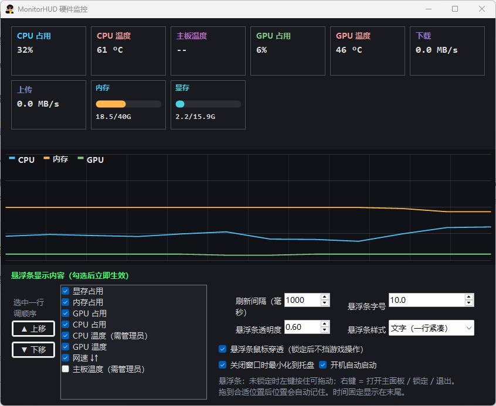

# MonitorHUD

桌面硬件监控悬浮条 + 主面板，类 Game++ 风格。屏幕顶部一根半透明悬浮条实时显示硬件状态，点开主面板可看数值卡片、曲线图和详细设置。



## 功能

- **悬浮条**：CPU 占用 / CPU 温度 / 主板温度 / 内存占用 / GPU 占用 / 显存占用 / GPU 温度 / 网速（下载↑上传↓），末尾固定显示秒级系统时间（与任务栏一致）。
- **两种样式**：文字（一行紧凑）/ 卡片（带进度条），字号、透明度可调。
- **固定所有虚拟桌面**：用 `Win+Tab` 切到桌面二、三，悬浮条依然可见；主面板只留在启动它的桌面。
- **单实例**：重复双击 exe 不会开第二个进程、第二根悬浮条，只会把已运行的主面板唤出来。
- **托盘**：关闭窗口最小化到托盘；双击托盘图标或右键菜单「打开主面板」唤出；右键菜单另有「重新启动」（先拉起新进程再关掉自己，配置、悬浮条位置全部保留）和「以管理员身份重新启动」（弹 UAC 提权后重启，用于读取 CPU / 主板温度）。
- **开机自启**：主面板勾选「开机自动启动」即写入当前用户启动项（`HKCU\Software\Microsoft\Windows\CurrentVersion\Run`），不需要管理员权限；勾选状态直接读注册表，被外部工具清理过也能如实显示。
- **自定义**：勾选决定悬浮条显示哪些项，上移/下移调整顺序，位置自动记忆，拖到屏幕顶部自动磁力吸附。
- **鼠标穿透**：锁定后悬浮条不挡游戏/鼠标操作。
- **配置持久化**：所有设置写入 `%APPDATA%\MonitorHUD\config.json`，重启保留。

## 下载与运行

exe 直接放在仓库里，任选一种方式取：

- **直接下载（推荐）**：点开 [`dist/MonitorHUD.exe`](dist/MonitorHUD.exe)，点右上角「Download raw file」。这份与当前源码同步，是最新版。
- **Releases**：历史版本见 [Releases](https://github.com/jyp74664-ops/MonitorHUD/releases)。

程序为单文件发布，双击即可运行，但**需要本机已安装 .NET 10 桌面运行时**（.NET Desktop Runtime）。未安装时系统会提示缺少运行时，不会静默失败。

- **显示 CPU / 主板温度需要以管理员身份运行**：程序跑起来后，右键托盘图标 → 「以管理员身份重新启动」，在 UAC 弹窗点「是」即可，不用重新找 exe。温度来自 WMI 热区（`MSAcpi_ThermalZoneTemperature`），非管理员权限读不到；UAC 点「否」则维持当前实例继续运行，不会把程序关掉。
- GPU 占用 / 显存 / GPU 温度来自 `nvidia-smi`，需要 NVIDIA 驱动；无 NVIDIA 显卡时这几项留空，其余功能正常。
- 首次运行悬浮条在屏幕顶端，位置可用鼠标拖动（未锁定时）。

## 操作

**悬浮条**
- 未锁定时左键按住可拖动，靠近屏幕顶边自动吸附。
- 右键菜单：打开主面板 / 锁定（鼠标穿透）/ 退出。

**主面板**
- 左侧勾选列表：点文字行只选中（用于调顺序），点方框或按空格切换是否显示。
- 「▲上移」「▼下移」：调整选中项在悬浮条上的显示顺序。
- 右侧：刷新间隔（500–5000ms）、悬浮条字号（8–20）、透明度（0.30–1.00）、样式。
- 关闭窗口：按设置最小化到托盘或真正退出。

## 从源码构建

需要 .NET 10 SDK（Windows）：

```bash
dotnet build MonitorHUD.csproj -c Release
dotnet publish MonitorHUD.csproj -c Release -r win-x64 --self-contained false -p:PublishSingleFile=true -o publish
```

产物为 `publish\MonitorHUD.exe`（单文件，需本机已装 .NET 10 运行时）。

## 实现说明

- C# / WinForms（.NET 10），单文件发布。
- CPU / 内存：原生 P/Invoke；网速：网卡累计字节数差值；GPU：`nvidia-smi` 子进程；温度：WMI 热区（启发式：温度最高的热区当 CPU，第二高当主板）。
- 虚拟桌面固定走 `IVirtualDesktopPinnedApps.PinView`，守护用 `DWMWA_CLOAKED` 判断窗口是否真被系统隐藏；悬浮条是独立顶层窗口（非主面板附属窗口），否则切桌面时会被连带隐藏。
- 程序图标为项目内 `app.ico`，同时嵌入程序集供单文件发布时托盘/窗口使用。
- 「重新启动」不是简单地 terminate + start：新进程带 `--restart-after <旧PID>` 参数启动，在抢单实例 Mutex 之前先等旧进程彻底退出。否则新进程会把自己判成"重复实例"，唤醒旧进程后自己退出，外部观察就是程序被关掉了。「以管理员身份重新启动」走同一套机制，只是启动信息多一个 `runas` 谓词——管理员与普通权限共用同名 Mutex，不等待一样会撞车。
- 提权被拒绝时抛 `Win32Exception`（`ERROR_CANCELLED` = 1223），此时只提示、不退出当前实例；否则就成了"点了没反应还把自己关了"。
- 开机自启只写 `HKCU`，不改 HKLM、不装服务、不需要提权。判断是否已开启时会校验注册表路径与当前 exe 路径是否一致，程序被挪过位置就视为未开启。

## 已知限制

- **管理员模式下程序占用自身 exe，普通权限无法覆盖更新**：需要先在托盘「退出」，再替换文件。开机自启项以普通权限运行，所以开机后仍读不到温度——要开机即以管理员运行，得改用任务计划程序（`schtasks /create /rl highest`），本程序未内置。
- 主板温度依赖主板暴露的 ACPI 热区；本机只有一个热区时，「主板温度」可能与 CPU 温度相同或读不到。这不是程序 bug。
- 温度读取为启发式，不保证所有主板型号都准确。
- 无 NVIDIA 显卡时 GPU 相关项不显示数据。
